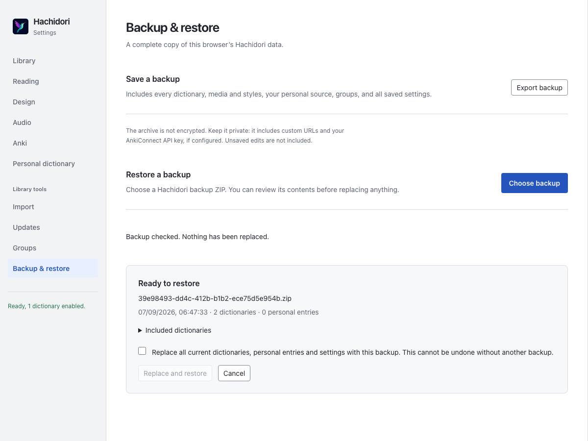

# Backup archive

L2 follows GSM PR #549 at `524ed0b3b92decae87f65df02df9ef9e512f7674`:
prepare and validate an immutable archive, install fresh dictionary generations,
publish the complete state transaction, then clean superseded generations.
Desktop paths, profiles and application-backup plumbing are not portable.

## Using a backup

Settings → Backup & restore exports every installed dictionary, including
disabled packages and generated media, plus dictionary order, aliases,
favourites, groups, managed-source/update metadata, the personal source document,
reader/Design/audio/Anki settings, update schedules, local lookup counts and the
words marked as known or ignored for word highlighting. The archive is
unencrypted and can contain personal notes, custom URLs and API keys. Keep it
private. It does not contain browser history, downloads, cached runtime results,
or Anki's own collection/media database.

Update eligibility is preserved, not inferred from Yomitan's `isUpdatable` flag
alone. A local archive with incomplete or non-HTTPS source URLs remains local
and not update-checkable; a complete managed source stays managed. Reimports
retain the committed source metadata even when the newer native index differs.

The `downloads` permission saves the engine-owned archive through Chrome's save
dialog. Chrome owns progress and cancellation. Its download ID and temporary
blob URL are tracked in session storage, surviving service-worker restarts;
completion or interruption releases the URL. Those temporary records are not
backup content.

With direct OPFS the archive is an OPFS file under `.hdw-backup-files/`. Export
reads each dictionary file as it writes the archive there, and Chrome downloads
that file; a chosen backup is copied there and restored from it in place.
Neither is held in memory or in browser Blob storage. Earlier versions
assembled the archive from Blobs, about twice the library's size; once that
exceeded what Chrome could keep in memory or page to disk, the Blob broke and
Chrome failed the download as **Check internet connection** (#577). Releasing
an export, or finishing a preparation, removes its file, and the engine's start
removes any that a closed browser left. IDBFS hosts keep the Blob path.

Choosing a backup validates and stages it before showing its date and dictionary
list. Nothing is published until the replacement checkbox is selected and
**Replace and restore** is pressed. This replaces the entire saved configuration,
including empty/default values; it does not merge libraries. Cancel discards the
prepared files. A concurrent saved edit requires preparing the backup again.
A backup made by any Hachidori version restores its dictionaries. Its settings
are read one by one, the way a stored record is: a setting this version does
not know or cannot read is skipped, and one the backup does not have keeps its
default. Experimental feature switches restore by name: known switches keep
their saved values, newer ones start off and retired ones are dropped. Lookup
statistics this version cannot read are skipped too. Dictionary selections that
are unavailable in the restored library are reset.
Unsaved Settings drafts must be saved or discarded before starting an operation.
Leaving Settings cancels its preparation using an ID allocated before the
request starts. The background retires delayed/retrying preparation requests;
the engine queues token-scoped cleanup even behind another active mutation.
Cleanup does not depend on the closed page receiving a preparation reply.

## Automatic snapshots

The service worker keeps the newest automatic snapshots in the browser profile
under the `automaticBackups` storage key. The `automaticBackupDays` reader
option (Settings → Backup & restore, 1–30, default 2) sets how many are kept;
with one snapshot per 24 hours that count is the number of days retained. The
limit read from the state being snapshotted applies when the next record is
written, so lowering it prunes at the next snapshot rather than immediately.
The upper bound exists because every record is a complete saved-state payload
with lookup-statistics rows. An absent key initializes as schema
version 1 on the first successful snapshot; an unsupported future schema fails
closed without replacing metadata or cleaning dictionary files. Snapshot
creation is serialized with other storage writes, timestamped when that queued
operation runs, and limited to one successful snapshot per 24 hours. The
nonperiodic `hachidori-automatic-backup` alarm is recreated from retained
metadata after worker or browser restart.

Each record uses the same complete snapshot and lookup-statistics rows as a
manual export. It therefore retains personal entries, custom URLs, saved
settings and a configured AnkiConnect API key as well as dictionary metadata.
The records stay on this device and are not ZIP archives or cloud uploads.
Clearing a value from current settings does not remove it from an older retained
snapshot; later successful snapshots replace it through the retention count.

Dictionary files are immutable generation roots. Automatic records reference
those existing roots in place, so several snapshots can share one generation
without copying its blobs or issuing a filesystem write. Every ordinary
generation cleanup and restart reconciliation includes roots referenced by
every retained record. The one-key metadata replacement becomes authoritative before
any newly unreferenced generation may be removed. A refused write performs no
cleanup; a lost reply requires exact readback; an uncertain outcome retains the
roots. Cleanup after confirmed replacement is best effort and can be completed
by a later reload.

Corrupt records are validated independently, so a damaged newest record does
not hide a valid older one. Invalid or incomplete metadata, including an
unsupported index schema, makes root discovery incomplete and suppresses
generation cleanup. Preparing a restore rejects malformed generation paths
before filesystem access and validates the retained files in place. Settings
shows each valid record's actual relative age and uses the same preview,
replacement checkbox and **Replace and restore** action as manual restore.
Incompatible reader settings do not make an automatic snapshot corrupt or hide
it from the list; restore uses the same settings fallback as a manual archive.

Linked clients suspend their local automatic-backup alarm and do not snapshot
the mirrored host state. Their existing local records remain in the browser
profile. Confirmed unlink restores the kept local state, then reconciles the
local snapshots and alarm again.

## Transaction and recovery

Export, prepare, restore and cancellation use the existing engine mutation queue
and offscreen admission lock. Export captures one complete storage snapshot and
leases the committed generations while collecting their files. The ZIP module
loads only when backup work is requested; ordinary lookup does not load it.

Preparation validates archive entries and the complete persisted-state contract,
writes fresh generation roots, persists them, and strict-loads all packages,
including disabled ones. It then restores the working loaded set without
publishing a new logical generation. A damaged current installation does not
prevent restoring a valid backup.

Confirmation checks the exact raw six-key preparation snapshot, strict-loads
the candidate again, and publishes `dictionaryState`, `options`,
`customDictionarySource`, `dictionaryUpdates`, `lookupStats` and
`wordStatusOverrides`, together with the restored statistics rows, in one
background storage write.
Each local revision advances; archived revision numbers and generation paths are
not adopted. The storage queue is never held while awaiting the engine.
Schedule reconciliation runs after the storage commit.

A lost commit reply is resolved by reading back the exact expected six-value
transaction. Confirmed success publishes the new engine generation and cleans
superseded roots. Confirmed failure restores authoritative state and removes
unpublished roots. An uncertain commit retains both sets for restart recovery.
Post-commit alarm or Settings-refresh errors are reported separately from restore
success so they do not invite a duplicate operation.

Statistics rows use a fresh namespace on each restore. Its descriptor is part
of the atomic publication and constant-size lost-reply readback; archived row
keys are never adopted. A concurrent lookup invalidates a prepared restore just
like a settings edit. Only confirmed success permits best-effort pruning of
inactive statistics namespaces. Cleanup failure cannot make the restore
retryable; an uncertain commit retains both namespaces.

The focused archive/state/download/Settings unit tests cover format and control
contracts, including large-file export and restore with a failing Response Blob
sink, existing ZIP64 compatibility, and empty payloads.
`test/backup-engine-scenarios.mjs`, included by extension smoke, covers
automatic cadence, retention, shared real generations, malformed paths, schema
failure, lost replies, storage failures, uncertain commits, corrupt-newest
fallback, interrupted cleanup, disabled-package validation, damaged-installation
recovery, unreadable settings and empty restores through real WASM. It also
restores the archives the 0.1.1 and 0.3.0 releases exported, in
`test/data/backups/`, and restores this version's export of each again.
Nine shared browser assertions in `test/chrome-backup-scenarios.mjs` exercise
automatic relative ages, confirmation and a real oldest-retained-snapshot
restore that brings back its saved retention count, plus the actual Chrome
download, immutable preview/conflict, complete restore, corrupt-archive cleanup
and actual page closure during staged preparation, dictionary restore with
unreadable settings and a 16 MiB binary restore/re-export in both OPFS
and IDBFS suites, followed by browser restart.
`test/backup-profiles.test.mjs` covers version 4 against the worker and the
real WebAssembly engine, and `test/chrome-languages/backup.mjs` in real
Chrome, including a restore in the released build that
`test/chrome-backup-release.mjs` pins.

## Archive representation

The extension format is a stored ZIP64 archive. Native dictionary data is already
compressed; storing it avoids recompression and allows files and archives larger
than classic ZIP's representation. `hachidori-backup.json` identifies format
`hachidori-backup`, version 3, creation time, the persisted-state snapshot,
`lookupStatsRows` (term, reading, count and first/last lookup timestamps), and the
exact file list with sizes. Payload names are `dictionaries/<ordinal>/<relative
file path>`; paths from a backup are never used as live generation paths.
Version 1 archives remain readable and restore an empty statistics collection,
not the current browser's unrelated history. Version 2 adds a descriptor and
canonical, unique term/reading rows; statistics that are missing or cannot be
read restore empty in the same way. Version 3 adds the snapshot's
`wordStatusOverrides`, `{ revision, known, ignored }` with each headword under one
status; versions 1 and 2 restore none, as does an automatic snapshot taken
before it existed. A one-dictionary archive from the relay's download carries
none either. A newer version's archive is read as version 3, skipping what it
added.

### Version 4: languages

An installation with only Japanese, and no other language's personal
dictionary, counts or marked words, keeps writing version 3, byte for byte,
and the automatic snapshots it always wrote. Once it holds another language
([languages.md](languages.md) section 17.2, decision record
[0012](decisions/0012-backups-readable-by-older-builds.md)), every backup is
version 4:

- `snapshot` is a valid version 3 snapshot of the installation's **Japanese
  view**: the Japanese profile's settings flattened with the settings every
  language shares (or the shared settings alone when there is no Japanese
  profile); a schema 1 dictionary state with the Japanese personal dictionary
  first and enabled, the Japanese profile's dictionaries in its order, and every
  other dictionary disabled, except other languages' personal dictionaries,
  which it leaves out; the Japanese groups; and the Japanese personal document,
  marked words and lookup rows. A build from before languages restores this
  part, dictionaries included, and skips the rest.
- `profiles` holds `options` (the complete record with every profile),
  `dictionaryState` (schema 2: every package once, and each profile's list
  and groups), and `languages`, one entry per other language with a
  `document` (`{ revision, semanticRevision, text }`), `wordStatusOverrides`
  (`{ known, ignored }`) and `lookupStatsRows`, each present when the language
  has one.
- The archive's files are those of the packages the snapshot lists. Other
  languages' personal dictionaries are not archived; a restore compiles each
  from its document into a fresh generation, as a save in Settings does, and
  keeps its display name and favourite.

Automatic snapshots store the same object (`snapshot`, `lookupStatsRows` and
`profiles`). Their validator checks the snapshot as before and `profiles` by
the version 4 rules, so a snapshot with languages is never counted as corrupt,
and the roots it protects are those of every package either part names, other
languages' personal dictionaries included. The relay's dictionary download
reads the Japanese view, so it never offers another language's personal
dictionary.

A version 4 restore validates the snapshot as before and `profiles` beside it:
the snapshot must be the Japanese view of the complete records, and every
language's personal dictionary must match its document and sit first and
enabled in that language's profiles only. It restores every language this
build has a pack for. A language it has no pack for is left out with its
profile, personal dictionary, document, counts and marked words; its other
dictionaries stay in the library, in no profile, and the preview says
*Vietnamese needs a newer Hachidori and is not restored.* When no profile of
the backup remains (an installation set up in a language this build lacks),
the restore builds the Japanese profile from the backup's Japanese view, as an
older build would, keeps the other languages it has packs for, and the preview
says *The Japanese settings and dictionaries are restored in place of
Vietnamese.* Each profile's dictionary selections are pruned against its own
dictionaries and groups. The preview also names the restored languages and
every language of the current installation whose data the restore removes.

The restore writes every language's personal document one revision above the
current one, a language that keeps a profile but has no document in the backup
getting an emptied one, so open Settings pages adopt it; Japanese and every
other language with counts get a fresh count generation, and the restored rows
are written under it in the same storage write. `hd_backup_cas` checks the
restored records as a backup before writing them, together with those
revisions and generations. The packs of the restored profiles load before the
restore publishes, so the first lookup after it finds its language. The
installation's own language choice (`languageSelection`) is kept, except that a
restore whose result is Japanese-only removes it. A version 1 to 3 backup
restores as one Japanese profile, as before.

Every entry's CRC32, declared size, path and ZIP headers are validated before
restore. CRC32 detects accidental corruption, not authenticity: only restore
archives you trust. Unlike GSM's Node streaming SHA-256 implementation, the
browser format uses ZIP's streaming checksum without buffering a whole native
file for WebCrypto. There are no product size or entry-count caps. Available
browser storage and the ZIP/browser numeric representation remain constraints.

The lazy backup module uses zip.js 2.11.2, vendored from commit
`3b81b8f79d2abd2bc0ac1f09afd7e933effced62`, under its BSD-3-Clause license in
`extension/vendor/zip-LICENSE`. `extension/vendor/zip.js` is the unmodified
`dist/zip-core-external.min.js` (SHA-256
`09a4776c6baf40f3e2aa0c7c66199f6aa3ebdefc927e83dcaf1dfffd432f9bac`).
It runs in the existing engine context with additional workers disabled. Only
stored, unencrypted regular files are part of this format, so neither external
codecs nor an additional WebAssembly binary are needed. Export reads each file
in zip.js chunks and writes to the OPFS file, or on IDBFS to a zip.js `Writer`
that snapshots each output chunk into a Blob, avoiding the `BlobWriter`
Response-stream sink and a single archive-sized typed array. Extraction checks
each stored entry's CRC32 without keeping its bytes and then slices the entry
from the archive itself.
This is not a GSM or general-purpose ZIP importer.
