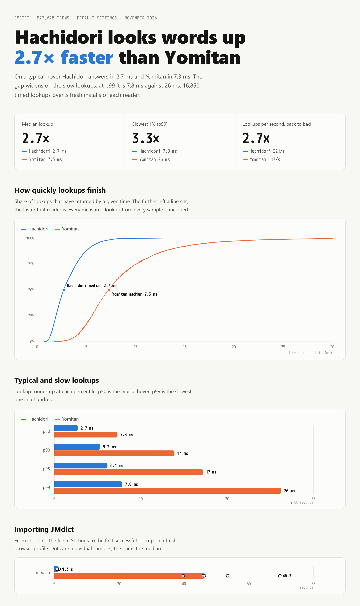

# JMdict lookup: Hachidori vs Yomitan

Hachidori looks words up in JMdict **2.7× faster than Yomitan at the median
(2.71 ms vs 7.30 ms)** and **3.3× faster at p99 (7.84 ms vs 26.25 ms)**, with
both readers on their shipped defaults. Importing JMdict to the first
successful lookup takes **1.3 s in Hachidori and 46.3 s in Yomitan** (medians).
Both readers returned the same number of entries for every lookup.



## Results

16,850 timed lookups, 8,425 per reader: 5 fresh installs × 5 passes × 337
lookups. Percentiles pool every measured lookup.

| Metric | Hachidori | Yomitan | Ratio |
| --- | ---: | ---: | ---: |
| Lookup p50 | 2.71 ms | 7.30 ms | 2.7× |
| Lookup p90 | 5.29 ms | 13.90 ms | 2.6× |
| Lookup p95 | 6.14 ms | 17.20 ms | 2.8× |
| Lookup p99 | 7.84 ms | 26.25 ms | 3.3× |
| Mean lookup | 3.11 ms | 8.53 ms | 2.7× |
| Slowest lookup | 13.13 ms | 87.80 ms | |
| Lookups per second, back to back | 321 | 117 | 2.7× |
| Per-install lookup p50 | 2.37–3.46 ms | 6.80–7.60 ms | |
| Import to first lookup, per install | 0.9–1.5 s | 39.8–69.6 s | 36× (medians) |
| First lookup after import, per install | 3.7–10.3 ms | 6.9–9.5 ms | |

For the 295 lookups with fewer than 32 entries, both readers returned the same
headwords. In 22 of the 42 lookups that reached the 32-entry limit, they kept
different entries.

An earlier exploratory run of the same workload, whose data is not kept,
measured 6.5 ms vs 17.0 ms at p50 (2.6×) and 16.5 ms vs 58.1 ms at p99 (3.5×)
on the same laptop in a slower power state. The absolute times moved with the
machine; the ratio held.

## Setup

- Hachidori `extension/` from main
  [`56880114`](https://github.com/bee-san/hachidori/commit/56880114dced471280d0f8dc89686952c754f53f);
  Yomitan [26.10.12.0](https://github.com/yomidevs/yomitan/releases/tag/26.10.12.0)
  (`yomitan-chrome.zip`, SHA-256 `270bf736…8a414aa7`);
  [JMdict English 2026-11-01](https://github.com/yomidevs/jmdict-yomitan/releases/tag/2026-11-01)
  (`JMdict_english.zip`, 527,628 terms, SHA-256 `5887ae93…63c071d2`).
- Both readers unmodified on their defaults: a 16-character scan and up to 32
  results.
- The lookups imitate reading. Each one starts at a character of public-domain
  prose (Natsume Sōseki, Akutagawa, Dazai) or a few everyday sentences and
  scans the next 16 characters, as a hover would: 333 scans with inflections,
  particles, kana and kanji, plus 食べる, 食べたかった, 日本 and one guaranteed miss.
- Each sample imports the archive into a fresh profile through the reader's
  own Settings file input, runs one excluded warmup pass, then times five
  passes. The readers alternate, one at a time; the first install of each is
  an excluded warmup.
- A lookup is timed on the extension page around the reader's own backend
  message: Hachidori's `hd_lookup` through the service worker and offscreen
  document to the threaded WebAssembly engine, Yomitan's `termsFind` through
  its own backend. Hover delay and popup rendering are excluded for both.
  Yomitan's pages are not cross-origin isolated, so Chrome reports their clock
  in 0.1 ms steps; Hachidori's get 5 µs steps.
- Import time runs from choosing the file to the first successful lookup.
- Intel Core Ultra 7 165U laptop (14 threads), Arch Linux, Chromium
  156.0.8078.79 headless, Puppeteer 25.10.0, Node 26.12.1. Profiles lived on
  tmpfs. A background backup kept system I/O pressure high during the run; it
  affected both readers' alternating samples alike.

## Failed attempts

Five Yomitan attempts finished importing but never had JMdict switched on in
Yomitan's own settings. The harness's fallback click into the dictionaries
modal then hung until the 5-minute protocol timeout. The settings page logged
`displaySetCustomCss: frame state invalid` from its popup preview in these
attempts. Each was discarded and repeated in a fresh profile. No Hachidori attempt
failed.

## Reproduce

```sh
gh release download 2026-11-01 -R yomidevs/jmdict-yomitan -p JMdict_english.zip
gh release download 26.10.12.0 -R yomidevs/yomitan -p yomitan-chrome.zip
node benchmark/jmdict-lookup.mjs --jmdict JMdict_english.zip \
  --yomitan yomitan-chrome.zip --output /tmp/jmdict-lookup
```

`benchmark/results/jmdict-lookup/` keeps this run: the gzip-compressed
definition, every raw sample (each lookup's latency and response hash) and the
failed attempts, with paths and the hostname redacted, plus `summary.json` and
`summary.md`. Recompute the summary from the kept files with:

```sh
mkdir /tmp/jmdict-kept
gunzip -c benchmark/results/jmdict-lookup/definition.json.gz > /tmp/jmdict-kept/definition.json
gunzip -c benchmark/results/jmdict-lookup/raw.jsonl.gz > /tmp/jmdict-kept/raw.jsonl
node benchmark/jmdict-lookup.mjs --summarize-only --output /tmp/jmdict-kept
```
