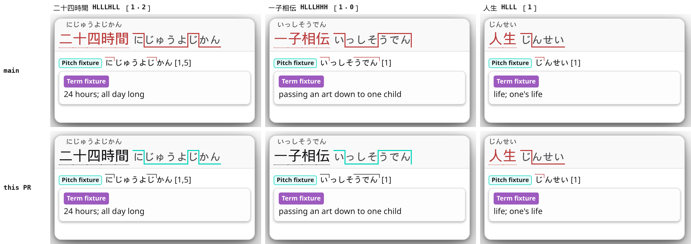
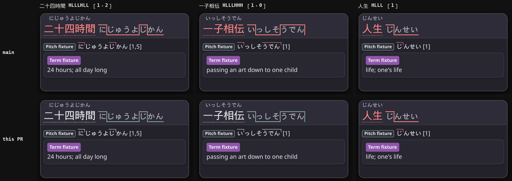

<!-- SPDX-License-Identifier: GPL-3.0-or-later -->

# Issue #596 evidence: pitch colours for words of several accent phrases

No dictionary data is stored here. The scripts read archives downloaded
locally; paths in them are the author's machine. Compared revisions: `main`
5f986e47 and the PR head (the classifier is unchanged since 26277de2).

## Screenshots

`shots.mjs <extension dir> <prefix>` renders the production popup view,
`glossary.js` and `reader.css` of one checkout in headless Chrome for Testing
152.0.7977.75 with **Show pitch accent colours** on and the default Contour
reading style. Each lookup is a synthetic term in the engine's reply shape
with one pitch given as a Yomitan H/L pattern, which hoshidicts hands over as
`{ position: 0, pattern }`. `grid.py` lays out `main` above the PR.

- 二十四時間 HLLLHLL, NHK [1・2] に＼じゅう・よじ＼かん, the issue's word;
- 一子相伝 HLLLHHH, NHK [1・0] い＼っし・そうでん: one downstep, then a rise;
- 人生 HLLL, [1]: one phrase, which keeps its colour.

What `shots.mjs` read from each page: on `main` both multi-phrase headwords
and badges are `atamadaka`, drawn `rgb(187, 58, 58)` (light) and
`rgb(255, 134, 134)` (dark); on the PR they have no group and are drawn in the
popup's text colour. 人生 is `atamadaka` on both.

## Which pitch data is affected

`survey.py` counted the positions of six pitch dictionaries: NHK2016,
大辞林 第四版, 大辞泉, 三省堂 第八版 and 新明解 第八版 (MarvNC's collection) and
Kanjium Pitch Accents 1.0.0. All 653,481 pitches are downstep numbers; none is
an H/L string. Yomitan added H/L strings in yomidevs/yomitan#2055 for
"words/phrases with multiple downsteps".

The screenshot in #605 shows `main` drawing 二十四時間 red with its reading
drawn with two drops (に＼じゅうよじ＼かん). The reading shows one pitch, and a
downstep number has one drop, so that pitch was an H/L pattern: HLLLHLL, which
`main` colours by its first downstep.

## Before and after on real pronunciations

`nhk_patterns.py` turns every pronunciation of NHK日本語発音アクセント新辞典
(a term dictionary that writes 二十四時間 as ［1・2］ニ＼ジュー・ヨジ＼カン) into
the H/L pattern a dictionary would give it, without and with the particle's
level: 86,471 pronunciations, 1,733 of them of several phrases. Lines showing a
particle, an inflected form or a `○○○` suffix template, whose morae are not the
reading's, are skipped. `compare.mjs` classifies each with `main`'s and the
PR's `HDGlossary.pitchAccentCategory`, as for a noun (no word classes).

| Pronunciations (each form) | Count | `main` | PR |
|---|---:|---|---|
| one phrase | 84,738 | its group | the same group (0 changed) |
| several phrases, `main`'s group is every phrase's (思う存分 [2・3]) | 240 | that group | none |
| several phrases, `main`'s group is only some phrases' (一子相伝 [1・0], 二十四時間 [1・2]) | 938 | the first phrase's group | none |
| several phrases, `main`'s group is no phrase's (音信不通 [0・0] LHHHLHH: nakadaka) | 551 | a group no phrase has | none |
| several phrases that never rise after the first downstep (十字を切る [0・1] LHHHHL) | 4 | nakadaka | nakadaka (unchanged) |

The last four look like one phrase: a phrase that starts high after a high
mora leaves no rise in the pattern. All 141,993 Kanjium downstep numbers keep
their group.

## Downstep lists are left alone

Yomitan's schema reads a term's `pitches` list as "different pitch accent
information", and so do Hachidori and Yomitan. Kanjium's 二十四時間 is `[1, 2]`,
NHK's ［1・2］ written as two accents, but `kanjium_lists.py` finds that rare:
of its lists of several numbers whose word NHK has, 5,633 are NHK's alternative
accents and 44 are NHK's phrases (2,267 match neither, or only partly). Giving
no group to every list would take the colour from 5,633 words to fix 44, so a
list keeps a group per accent, as on `main`. (NHK spells the word ２４時間, so
二十四時間 itself is not among the 44.)

## Yomitan d3c54c1

Its own `getPitchCategory` and `getDownstepPositions`
(`ext/js/language/ja/japanese.js:367-400`), run in Node:

| Pattern | `getDownstepPositions` | `getPitchCategory` |
|---|---|---|
| 二十四時間 HLLLHLL | [1, 5] | atamadaka |
| 十人十色 HLLLHLL | [1, 5] | atamadaka |
| 一子相伝 HLLLHHH | [1] | atamadaka |
| 我を張る LHLH (a verb) | [2] | kifuku |
| 月雪花 LHLHLHL | [2, 4, 6] | nakadaka |

## Timing

`bench.mjs` times `pitchAccentCategory` itself, `main` and the PR alternating
round by round (31 rounds each, Node 22.23.1, a shared 64-core host at load
53-87). Median ns per call, two runs each:

| Input | `main` | PR |
|---|---:|---:|
| 86,471 NHK pronunciations as H/L patterns, with the particle's level | 426.4, 425.7 | 417.0, 423.0 |
| only those of several phrases, 1,733 × 50 | 639.7, 637.8 | 249.3, 246.7 |
| 141,993 Kanjium downstep numbers | 288.9, 285.7 | 287.2, 285.8 |
| A/A (`main` against a copy of itself), same three inputs | 441.0, 649.5, 296.0 | 435.2, 651.0, 302.6 |

So the PR is within the A/A noise on one-phrase patterns and numbers, and
faster on multi-phrase patterns, which now return before the word-class and
mora work. The first version (616e84ad) tested a regular expression before the
downstep: +18.6 and +24.4 ns on the NHK patterns and +6.1 and +8.5 ns on the
numbers, so the check moved after the downstep (26277de2).

`render-bench.mjs` renders a 16-result reply (8 multi-phrase and 8 one-phrase
NHK words, each with its pattern, a one-phrase pattern and a number, so 64
classifications) through the production view and `reader.css`, `main` and the
PR in two pages of one Chrome 152, alternating, 300 samples after 20 warm-ups,
at load 122-142. Median `renderResults` 6.30 / 6.10 ms on `main` and 6.20 /
6.00 ms on the PR; with forced style and layout 22.0 / 20.7 ms and 21.0 /
20.4 ms. `main` colours 16 headwords and the PR 8.

## Archives

| Archive | SHA-256 |
|---|---|
| NHK日本語発音アクセント新辞典 (term dictionary) | `ef8c1832e8b69987b7eb89a15d193974264bc5720ddac287b92e87c3c67a080c` |
| [Pitch] NHK2016 | `f2c31294f26d6daf22c71178ffe5ab09f119321dff52d72acbf9a7c44092cbe9` |
| [Pitch] 大辞林第四版 | `b79b69457d3b9b302fce194e2964f5b78dd6cadbae3a30e18c3f50b7616407d7` |
| [Pitch] 大辞泉 | `213b417d9a406f54bf930140ff5b890fc4e8c88968b21284d991ac98037bc5fa` |
| [Pitch] 三省堂第八版 | `81cba723659547a6ceaefa2788956e44c6b7dd6147474c22bc48bc1561eb8cd8` |
| [Pitch] 新明解第八版 | `de78007d3241ce6433490b5433a6209c616b61db7c1c0ea4fd49d2cd186a3c1b` |
| `kanjium_pitch_accents.zip` (toasted-nutbread/yomichan-pitch-accent-dictionary 1.0.0) | `f89db29fd2cdec90fe6965d4ef1d92bfb59e201fc7b2f7b39f49a6cda2e99871` |

The MarvNC archives carry wrong CRC-32 fields; the scripts skip the check and
the data inflates as JSON.
