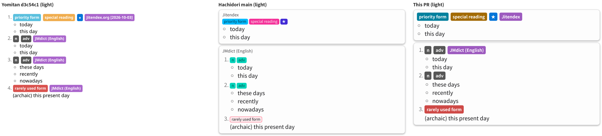
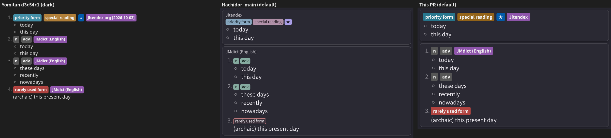
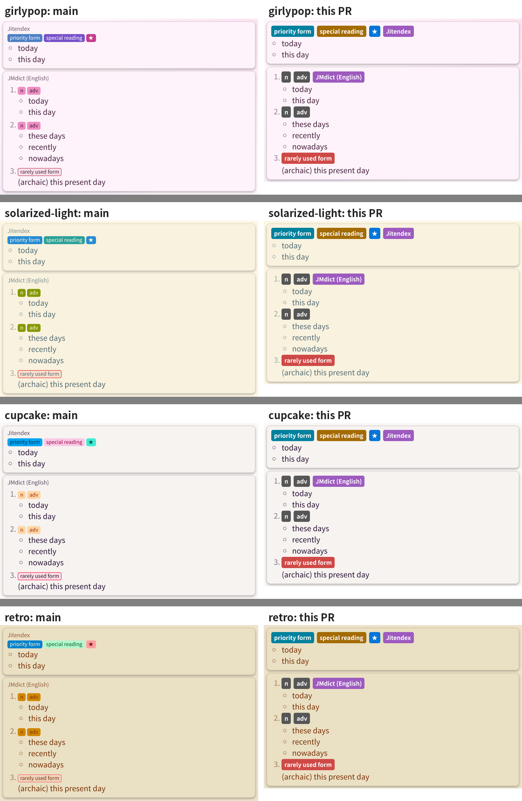
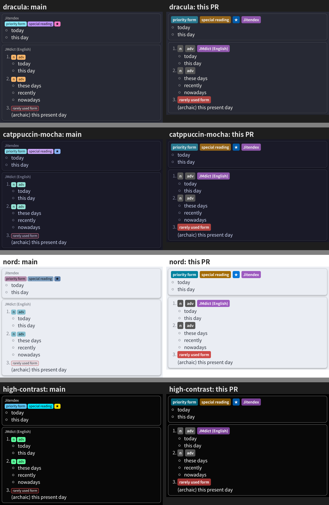
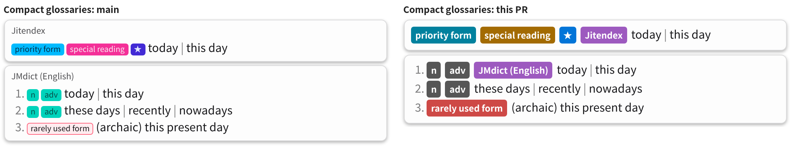
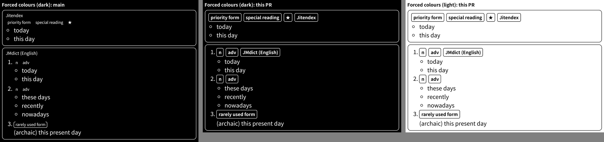

# Issue #604: Yomitan's look for definition tags — evidence

Evidence for the pull request that draws definition tags as Yomitan does and
moves each card's dictionary name into its first definition's tag row. Branch
head measured: `eaedc7f0` (on `main` `4745397e`); its `extension/` is unchanged
since `832bc01d`. Nothing here ships in the
extension; the scripts are scratch tools with this machine's paths in their
first lines.

## How it was produced

- `harness.mjs <label> <extension dir> [palette …]` renders one 今日 lookup
  through the production Default view (`HDPopup.createPopupView`, with
  `render/reader.css` adopted in a shadow root as `theme-host.js` does) in
  headless Chrome for Testing 152.0.7977.75, with Noto Sans CJK JP. The rows are
  synthetic: Jitendex's tag-bank rows for `priority form`, `special reading` and
  `★` (as in `test/yomitan-parity.test.mjs`), and three JMdict-shaped rows with
  `n`/`adv` and `rarely used form` tags. With the label `base` it also renders
  the same rows through Yomitan's own markup (`DisplayGenerator._createTag` and
  the definition-item template) and stylesheets (`material.css`, `display.css`,
  `structured-content.css`) at yomidevs/yomitan@d3c54c1, in its light and dark
  themes, with Compact tags off (Yomitan's default). It records each tag's
  computed colours, font, size and margins. `HARNESS_LAYOUT=compact` selects
  Compact glossaries and `HARNESS_FORCED=dark|light` emulates forced colours.
- `compose.py` builds the comparison images below from those captures.
- `tag-colours.mjs` derives the shipped colours: each of Yomitan's
  `--tag-*-background-color` values, darkened in OKLCH lightness only (hue and
  chroma kept, chroma reduced only where sRGB requires) until Yomitan's label
  (`#ffffff` light, `#f1f1f1` dark) reaches 4.5:1. With `TARGET = 7` and a
  white label it gives the High contrast palette's values.
- `contrast-table.mjs <main reader.css> <branch reader.css>` prints the label
  contrast of each category on `main` (each palette's colour and content pair,
  over all 42 palettes) and on this branch.

## Screenshots

Yomitan d3c54c1, `main` and this branch, light (Light palette) and dark
(Hachidori default palette):

Other palettes, `main` beside this branch:

Compact glossaries, and forced colours (each tag keeps an outline; on `main`
only the archaism tint had a border):

## Benchmark

`render-bench.mjs <first extension> <second extension> <iterations> <label>`
renders a ten-result reply (each result one structured Jitendex row with three
tags, five JMdict rows with two tags each and two untagged rows) through the
production view and `reader.css` in two tabs of one Chrome, one per tree. It
alternates the trees sample by sample after 20 excluded warmups and times
`renderResults` and then the style and layout it forces. An A/A run (two
copies of `main`) showed the second tab's `renderResults` 0.1–0.4 ms slower
than the first's whatever it renders, so each comparison was run twice with
the trees in swapped tabs; the table averages the two positions.

Chrome 152.0.7977.75, `main` `4745397e` against this branch's `extension/`
(unchanged since `832bc01d`), on a 64-core host shared with other jobs (load
average 55–66). `performance.now()` is coarsened to 0.1 ms here. 600 samples
per tab and palette in each of the two runs, 1,200 per tree:

| Palette | Tree | `renderResults` median / mean ms | + forced style and layout median / mean ms |
|---|---|---:|---:|
| Hachidori (dark) | `main` | 1.40 / 1.66 | 3.00 / 3.34 |
| Hachidori (dark) | branch | 1.40 / 1.66 | 3.10 / 3.35 |
| Light | `main` | 1.30 / 1.60 | 3.00 / 3.42 |
| Light | branch | 1.30 / 1.59 | 3.10 / 3.50 |

The A/A run's two tabs differed by 0.3–0.6 ms in mean total, more than any
difference above. A render builds one more tag and one fewer `div` per card.
These timings exclude engine lookup, messaging and paint.

## Contrast

Each tag's label on its fill. `main` used each palette's colour and content
pair (`archaism` a 12% error tint under the text colour, `dictionary` and
`name` the neutral pill); the branch's are fixed per colour scheme:

| Category | main: lowest of 42 palettes (palettes below 4.5:1) | this PR: light / dark / High contrast |
|---|---|---|
| `default` | 3.83 (2: solarized-light 4.39, pastel 3.83) | 4.51 / 4.83 / 7.07 |
| `name` | 3.83 (2: solarized-light 4.39, pastel 3.83) | 5.64 / 6.45 / 7.29 |
| `expression` | 2.93 (9: solarized-light 2.93, dark 3.05, aqua 3.57, light 3.05, bumblebee 4.09, emerald 3.86, valentine 3.85, pastel 4.31, fantasy 3.70) | 4.51 / 4.54 / 7.02 |
| `popular` | 3.41 (7: solarized-dark 4.08, solarized-light 3.41, dark 4.14, corporate 4.14, valentine 3.67, garden 3.84, winter 3.64) | 4.63 / 5.97 / 7.04 |
| `frequent` | 3.41 (9: solarized-dark 4.08, solarized-light 3.41, halloween 3.94, aqua 3.94, bumblebee 4.27, corporate 3.73, retro 3.70, pastel 3.60, girlypop 3.93) | 4.53 / 4.51 / 7.04 |
| `archaism` | 4.21 (1: solarized-light 4.21) | 4.50 / 4.99 / 7.01 |
| `dictionary` | 3.83 (2: solarized-light 4.39, pastel 3.83) | 4.52 / 4.54 / 7.05 |
| `partOfSpeech` | 2.97 (5: solarized-light 2.97, corporate 3.66, retro 3.14, garden 4.48, pastel 4.26) | 7.34 / 6.50 / 7.34 |

Yomitan's own labels (`#ffffff` light, `#f1f1f1` dark) measure 3.43/4.83
(`default`), 5.64/6.45 (`name`), 1.95/3.13 (`expression`), 4.63/5.97
(`popular`), 2.09/3.21 (`frequent`), 3.96/4.99 (`archaism`), 3.83/4.48
(`dictionary`), 2.48/3.43 (`frequency`) and 7.34/6.50 (`partOfSpeech`).
`test/definition-tag-colors.test.mjs` asserts the shipped values.

## Accessibility tree

`ax-probe.mjs` renders a two-card lookup on `main` and on this branch and dumps
Chrome's full accessibility tree, plain and with **On click only** blur active
(`HDPopup.createDefinitionReveal`), then clicks the first card's title (`main`)
or dictionary tag (branch). Both trees name each card's dictionary. While
blurred, both expose two `button "Reveal definitions"`. On `main` the title text
stays outside the inert list; on the branch the tag is inside it and returns with
the definitions. The click calls `reveal()` once on both.
