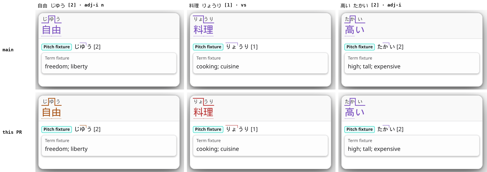
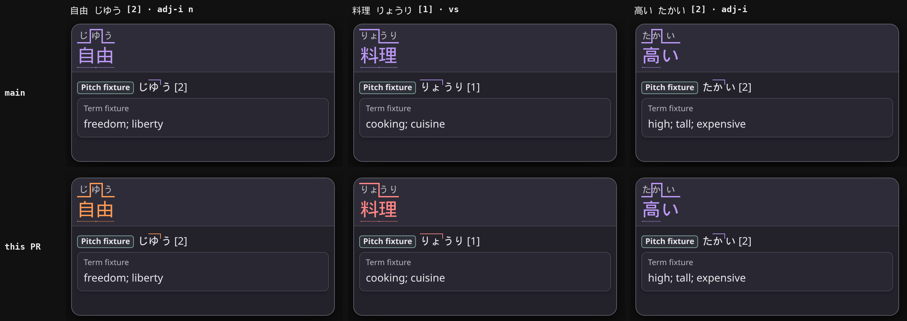

<!-- SPDX-License-Identifier: GPL-3.0-or-later -->

# Issue #608 evidence: kifuku from a dictionary's word class

No dictionary data is stored here. The scripts read archives downloaded
locally; paths in them are the author's machine.

## Screenshots

`shots.mjs <extension dir> <prefix>` renders the production popup view,
`glossary.js` and `reader.css` of one checkout in headless Chrome 152 with
**Show pitch accent colours** on. Each lookup is a synthetic term in the
engine's reply shape, with the word classes a dictionary gives it and one pitch.
`grid.py` lays out main (`origin/main` 4745397e) above this PR.

## Which dictionaries tag nouns with a verb or adjective class

`survey.py` read the term banks of about 110 archives (MarvNC's collection, the
ixodid collection, the recommended set) and kept only counts and the rules of a
few probe words. None of the recommended dictionaries gives 自由 a class. The
ones that give nouns or na-adjectives a verb or adjective class:

| Dictionary | Rules on nouns and na-adjectives |
|---|---|
| 講談社 日本語大辞典 第二版 (and 双解版) | `adj-i` on na-adjectives: 自由 `adj-i n`, 静か, 綺麗, 好き, 大切 |
| 精選版 日本国語大辞典 (MarvNC's copy) | `vs` on 10,337 headwords that do not end in する (料理, 授業, ランク, わくわく) |
| 旺文社標準国語辞典 第八版 | `vs` on 7,398 such headwords, 7,145 of them also `n`, which Yomitan already excludes |
| 漢字源 | `v5` on na-adjectives and nouns: 面倒, 陽気, 嫌, 坐 |

Yomitan d3c54c1 classifies the same way main does:
`getPitchCategory("じゆう", 2, isNonNounVerbOrAdjective(["adj-i", "n"]))` is
`kifuku`.

## Before and after on real data

`dump.py <term dictionaries> <pitch sources> <out.jsonl>` merges each
(expression, reading)'s rules across the term dictionaries, as hoshidicts
does, and keeps the ones with a class and a pitch. `compare.mjs` classifies
every pitch with main's and this PR's `HDGlossary.pitchAccentCategory`. Pitch
sources: NHK2016, 三省堂, 大辞林, 大辞泉 and 新明解 pitch dictionaries, and Kanjium's
`accents.txt`.

| Term dictionaries | Pitches of terms with a class | Changed |
|---|---:|---:|
| Jitendex 2026-10-03 | 15,720 | 0 |
| + JMdict, Bee's Ultimate Grammar, 新明解 8, 三省堂 8, NHK term dictionary | 20,485 | 0 |
| + 精選版 日本国語大辞典, 漢字源 | 30,784 | 3,073 kifuku → positional |
| Jitendex + 講談社 日本語大辞典 | 34,149 | 1,482 kifuku → positional, 自由 [2] → nakadaka |
| Jitendex, JMdict, 新明解 8, 三省堂 8, NHK term dictionary, 精選版, 漢字源, and seven ixodid dictionaries (講談社 日本語大辞典, 旺文社標準国語辞典, 学研 新世紀ビジュアル大辞典 and four 古語 dictionaries) | 93,442 | 2,625 kifuku → positional |

Every change is a kifuku pitch moved to its positional group. In the last row,
285 of the changed pitches are on headwords that end in a kana a verb or
adjective can end in; each is a suru noun (シュリンク `vs`), an onomatopoeic
adverb (ぷすぷす `adv vs`) or a na-adjective or noun (恥知らず `adj-i`,
スムース `adj-i`). The other changed pitches are on headwords that end in a kanji
or another character no dictionary form ends in. No verb or i-adjective written
in its dictionary form changed.

`parity.mjs` compares this PR with Yomitan's own functions over 14,994 cases (22
words, every downstep and H/L pattern, 14 class sets): equal wherever every
class fits the headword (10,436), otherwise only kifuku turned positional
(4,558), and 0 other differences.

## Timing

`bench.mjs` times `pitchAccentCategory` itself, main and this PR alternating
round by round (21 rounds each, Node 22.23.1, a shared 64-core host at load
about 71). Median ns per call, two runs:

| Input | main | this PR |
|---|---:|---:|
| 93,442 pitches of terms with a class | 249, 291 | 374, 415 |
| every Jitendex term with a pitch in NHK2016 or Kanjium (`dump-all.py`) | 320, 307 | 368, 362 |

`render-bench.mjs` renders a 16-result reply (each result with a class and three
pitches, so 64 classifications) through the production view and `reader.css`,
main and this PR in two pages of one Chrome 152, alternating, 300 samples after
20 warm-ups. Median `renderResults` 6.4 / 6.6 ms on main and 6.6 / 6.7 ms on
this PR; with forced style and layout 19.1 / 19.6 ms and 19.1 / 20.3 ms. The
expected cost, 64 × about 0.1 µs, is far below the run-to-run spread.
