<!-- SPDX-License-Identifier: GPL-3.0-or-later -->
# Crystal

Open **Design → Theme Store** and select **Crystal**.

Crystal is theme idea 5 in
[hachidori-themes#24](https://github.com/bee-san/hachidori-themes/issues/24): a
fine gold frame with corner scrolls and a blue crystal crest.
It has its own renderer. The word appears once, with a framed section under it
for each dictionary, where JL and Bee's Theme repeat the header per dictionary.

- **Colours:** **Design → Appearance → Colours** chooses one of three, as the
  owner asked in #24. **Grey** is a warm charcoal after FINAL FANTASY XIV's Dark
  window theme and **Beige** a parchment after its Light theme; both keep the
  gold frame and have red and gold buttons. **Retro blue** is the classic Final
  Fantasy menu window: a blue panel that deepens towards the bottom, a thin
  white border without scrolls, white text, silver ornaments and blue buttons.
  **Automatic**, the default, is Beige in the system's light mode and Grey in
  its dark mode, and follows a change at once. A choice recolours open popups
  and the preview without a new lookup; see
  [colour variants](README.md#colour-variants).

- **Header:** one per result. The headword is a large serif, the reading is
  gold (crimson on Beige) with Design's pitch marking (contour or overline), then the deinflection
  trail (`食べたかった ～た→たい`) and the frequency badges. A book marks a
  corpus count (a dictionary with `frequencyMode: occurrence-based`) and a star
  a rank. The first section's audio, Anki and pencil end the header.
- **Sections:** each dictionary is a framed section with a crystal plaque
  holding its name in small caps; a long name ends in an ellipsis and hovering
  shows it in full. A later section's controls sit on its banner. Two or more
  rows are numbered in diamonds, each with its tags as chips (hovering a
  chip shows the tag's notes), then the dictionary's formatted definition:
  structured content, furigana, links, tables and images, with the
  dictionary's scoped CSS. Example sentences sit behind a rule and circled
  numbers in monolingual text (①②) take the reading's colour.
- **Group tabs:** outlined small caps, the selected one a red plate with gold
  letters (silver in Retro blue) and an underline. All shows every section, followed by configured groups with
  results, as in Bee's Theme. A group hides the other sections in place, and a
  result's header hides with its last section. Audio, mining and keyboard
  actions follow the shown sections; Back restores an explicitly selected group.
- **Controls:** audio, Anki, the pencil, custom buttons and More are crimson
  plates with a gold rim and a gold icon (blue plates with a silver rim in Retro
  blue); a duplicate warning turns the Anki plate gold. Each section's audio and
  Anki buttons play and mine only its own
  dictionary. Custom buttons appear beside them; the first two as icons, the
  rest under More actions. Keyboard entry navigation moves between sections.
  Kanji view puts Back at the upper left; nested popups have Close at the right.
- **Personal dictionary:** the header's pencil opens the Note form beneath the
  header, and a later section's pencil beneath its banner. Escape closes the
  form before the popup; group presentation updates keep a draft.
- **Design settings:** Background opacity, Compact glossaries, Clicked-kanji
  dictionary, Show frequency dictionary names, Abbreviate large numbers, Show
  frequency averages, Show each dictionary's frequencies with the averages, Show
  pitch on the reading, Pitch accent dictionary, Reading pitch style, Image
  source, Image hover preview and Custom buttons.
- **Fonts:** none are bundled or downloaded. Latin text uses Noto Serif,
  Source Serif 4 or the system serif (Georgia, Cambria, Times New Roman) and
  Japanese uses Noto Serif CJK JP, Source Han Serif JP, Yu Mincho, Hiragino
  Mincho, BIZ UDPMincho or MS PMincho, then `serif`.
- **Forced colours:** Windows contrast themes get system colours, the same for
  all three colour choices. The crest, corner scrolls, plaques and gems are
  removed and the frame, sections and sense numbers become plain outlines.

The ornaments are inline SVG and CSS drawn for the theme, and the colours are
values chosen for it; no game art, interface textures, icons or fonts are used.
Sources and attribution are in `extension/vendor/themes/crystal/`; `source.json`
records the hachidori-themes revision. The readable SVG sources and the render
harness are on that repository's
[`previews/crystal-colours`](https://github.com/bee-san/hachidori-themes/tree/previews/crystal-colours) branch.

Most screenshots use small synthetic dictionaries with the mock-up's content;
the 300-pixel, Note and forced-colour ones come from the Store test's fixture
dictionary, with Colours on Automatic in a light system mode (Beige). The
300-pixel screenshot configures three optional actions to show More actions; a
new installation has no custom buttons.

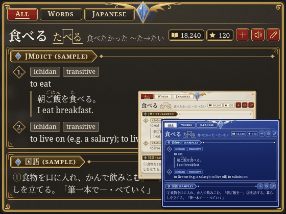
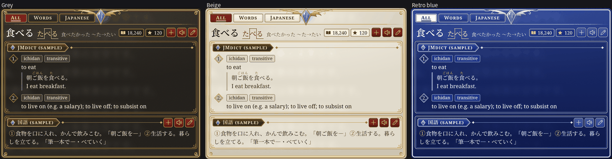
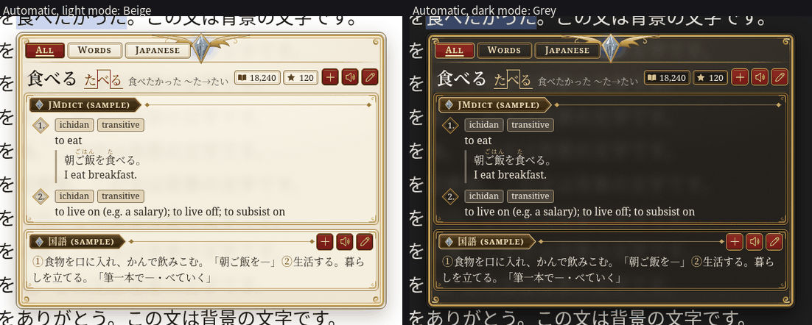
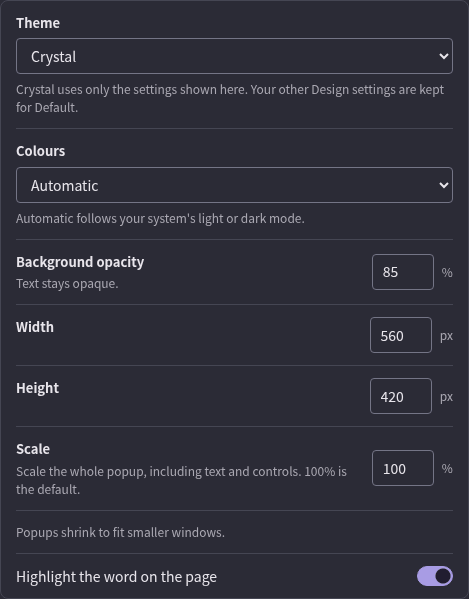
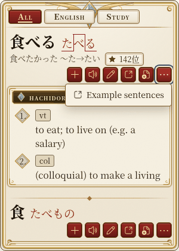
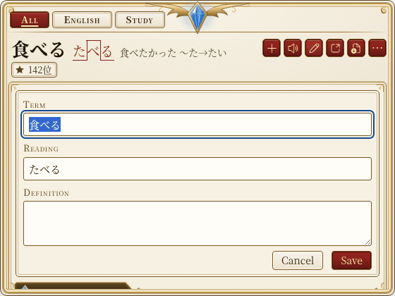
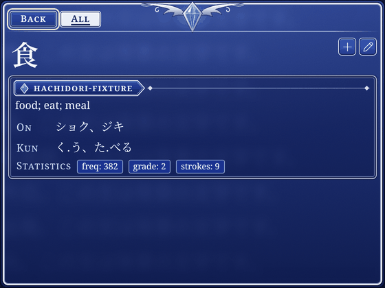
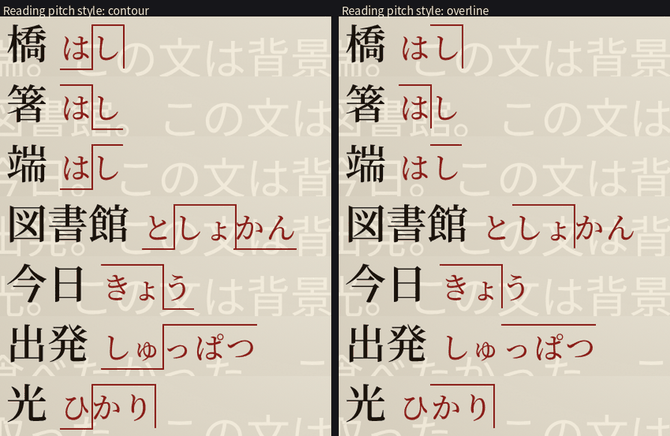
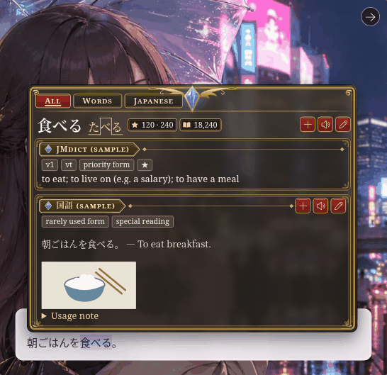

## Validation

`test/chrome-theme-store.mjs` uses the real extension, WASM importer and a local
fake AnkiConnect. For Crystal it checks one header per result and one section
per dictionary, each with its own audio and a ready Anki button; that the
header, banners and More actions stay inside a 300-pixel popup; that Escape
closes the Note form before the popup; that Colours lists Grey, Beige and Retro
blue, that each choice reaches the open popup and the Design preview with its
own panel colour, and that Automatic matches Beige in light mode and Grey in
dark mode; and WCAG AA text contrast (4.5:1) and border, icon and focus
contrast (3:1) with the default opacity composited over white and black pages,
in each colour choice and both forced-colour palettes.
`test/theme-renderer.test.mjs` covers the sections and their bindings, pitch,
frequency badges, circled numbers, group tabs and Back, Note placement and
drafts, More actions, native kanji mining and the Design settings Crystal
declares.

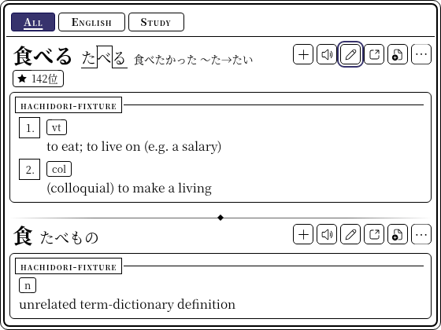
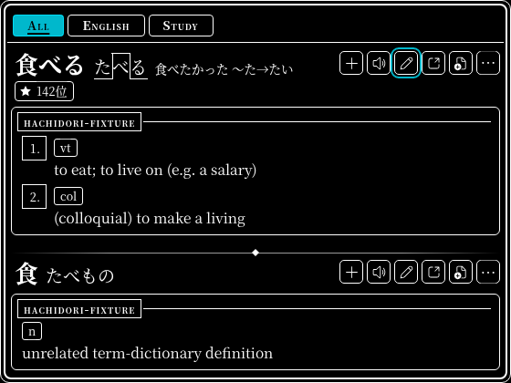

## Performance

The colour choices change the stylesheet, not the renderer; the module now
decodes 22 ornaments at load, four of them Retro blue's silver ones. The hover
benchmark below, run before (`b6e2328f`, navy) and after (Automatic, which
headless Chrome shows as Beige) in four alternating batches of six fresh
profiles each, found warm lookups unchanged: first correct frame
17.00 / 17.40 ms (median / p95) both times, complete stable result
33.30 / 33.50 ms, synchronous renderer 1.80 / 4.00 ms before and
1.70 / 4.10 ms after (576 hovers each). Cold first frames were 18.45 / 21.90 ms
before and 19.10 / 21.00 ms after (24 each); the batches' cold medians ranged
from 18.20 to 19.15 ms before and 18.55 to 20.30 ms after. A traced page load
with no lookup spent 49.55 ms on the page's main thread before and 50.40 ms
after (median of 32 loads in four alternating rounds, whose medians ranged from
48.3 to 50.1 ms before and 49.9 to 52.9 ms after). The machine was the shared
AMD EPYC 9R14 below, at a 1-minute load average of 13 to 24. The other
measurements below are from the first version.

In the first version, the first popup on a page waited for the serif faces and
its 18 SVG ornaments: a cold hover took 68 ms, against Bee's 17 ms. Now, when
the top frame loads the theme, the module measures a few characters in the
serif stack, which loads the faces, and decodes the stylesheet's ornaments.
That moves the work to page load: with Crystal selected and no lookup, a traced
page load spent 46.0 ms on the page's main thread against Bee's 38.1 ms (median
of 8 loads, `harness/load-cost.mjs` on the previews branch).

Bee against Crystal with the [hover benchmark](../../benchmark/README.md#hover-popup-and-glyph-hit-testing),
two batches of six fresh profiles each in alternating order:

| Measurement | Bee median / p95 | Crystal median / p95 |
| --- | ---: | ---: |
| Warm first correct frame (288) | 16.90 / 17.10 ms | 16.90 / 17.20 ms |
| Warm complete stable result (288) | 33.30 / 33.50 ms | 33.30 / 33.50 ms |
| Synchronous renderer (288) | 1.35 / 2.90 ms | 1.60 / 3.80 ms |
| Cold first correct frame (12) | 16.70 / 17.30 ms | 17.10 / 17.80 ms |
| Cold complete stable result (12) | 33.20 / 33.30 ms | 34.30 / 35.30 ms |

Warm and cold lookups land in the same frames as Bee's. An earlier run of the
same theme on the previous `main` had one cold hover in 12 at 50.5 ms. The
Theme Store's `Render 1.60 ms` is Crystal's synchronous renderer median from
this run, on a shared AMD EPYC 9R14 (64 logical CPUs) at a 1-minute load
average of 12 to 14, Node 22.23.1, headless Chrome 152.0.7977.75 with
`--disable-gpu` and Noto Sans CJK JP and Noto Serif CJK JP installed. The other
themes' labels come from an Intel Xeon, where Bee measured 1.30 ms; on this
machine Bee measured 1.35 ms. The backdrop blur was composited in software,
and its GPU cost was not measured.

To reproduce, with `popupTheme` set to `bee` or `crystal`:

```sh
HACHIDORI_PUPPETEER=/path/to/puppeteer-core.js \
HACHIDORI_CHROME=/path/to/chrome \
HACHIDORI_HOVER_SAMPLES=6 \
HACHIDORI_HOVER_OPTIONS='{"popupTheme":"crystal"}' \
  node benchmark/hover-popup.mjs /tmp/crystal-results \
  docs/themes/bee-evidence/bee-hover-fixture.zip \
  docs/themes/bee-evidence/bee-senses.zip
```
